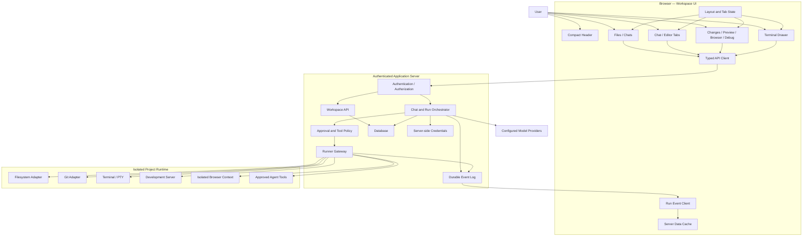
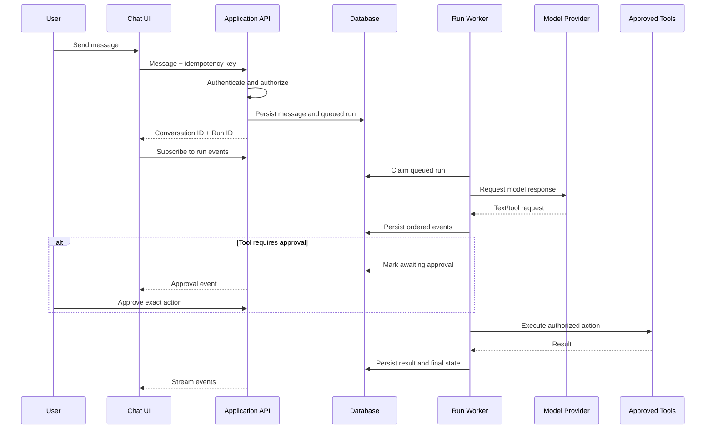
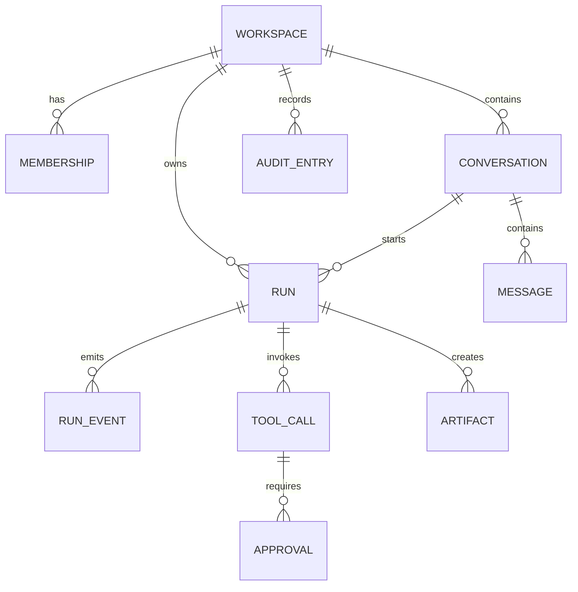

I’ll check the current repository and your reference images, then write a paste-ready blueprint for AI Studio—with architecture, starter code, backend contracts, a migration plan, and tests. I’ll keep advanced features available on secondary pages rather than crowding the front page.Below is a **paste-ready implementation blueprint for AI Studio**. It covers the front-page redesign, architecture, implementation code, backend contracts, security boundaries, migration order, and acceptance tests.

**Important:** this is an implementation specification with foundation code—not a claim that the repository has already been changed or tested. The implementing AI must inspect your uploaded repository before editing imports, dependencies, routes, or existing functionality.

# RAYBRAINOS2 — CHAT-FIRST WORKSPACE IMPLEMENTATION BLUEPRINT

**Suggested document name:** `RAYBRAINOS2_WORKSPACE_IMPLEMENTATION_BLUEPRINT.md`

---

## 1. Master instruction for AI Studio

Copy this instruction together with the blueprint and your repository:

> You are upgrading an existing application, not creating an unrelated replacement.
>
> Inspect the supplied repository before making changes. Preserve working integrations, existing project data, authentication, provider configuration, agent capabilities, and useful secondary features.
>
> Replace the current dashboard-first home experience with the chat-first workspace specified below.
>
> The default application screen must have:
>
> 1. A compact header.
> 2. One left sidebar for Files and Chats.
> 3. A central workspace for Chat and file-editor tabs.
> 4. An optional terminal drawer below the central workspace.
> 5. One right sidebar for Changes, Preview, Browser, and Debug.
>
> Both sidebars must be independently collapsible and resizable.
>
> The right sidebar and terminal must initially be closed.
>
> Keep advanced capabilities available through secondary routes and the command palette. Do not put dashboards, agent docks, health graphs, decorative visualizations, or management cards on the home workspace.
>
> Use the visual restraint of Claude Desktop, the workspace organization of Hermes Desktop, and the conversation-driven workflow of DeepSeek Harness as references. Do not copy proprietary branding, assets, or claim pixel-identical reproduction.
>
> Implement real functionality where backend capabilities exist. Where a capability is unavailable, show an honest unavailable state and explain the required connection. Never simulate successful execution, fabricate terminal output, invent Git changes, or present generated health metrics as real.
>
> Do not replace the project’s framework merely because your generation environment starts with a different template.
>
> Complete the work in the phases and acceptance criteria below. Run the available checks and report what actually passed.

---

## 2. Repository fit and research basis

The accessible repository excerpts show:

| Existing location | What it indicates | Implementation consequence |
|---|---|---|
| `package.json` | Next.js scripts | Preserve the existing framework unless a separate migration is explicitly requested |
| `src/app/page.tsx` | Home currently imports `CortexOS` | Replace the home composition, not the entire application |
| `src/components/cortex/cortex-os.tsx` | Existing OS/home shell | Extract reusable behavior; stop using the dashboard as the default home |
| `src/components/cortex/war-room.tsx` | Existing workspace shell | Reuse useful panels and integrations where practical |
| `src/lib/chat-engine.ts` | Header identifies a local demo engine | Trace the actual chat execution path before calling it live |
| `src/lib/api/http.ts` | Existing transport/environment layer | Audit and consolidate instead of adding a competing transport |
| `src/components/ui/resizable.tsx` | Existing resizable wrapper | Inspect its installed API before adding another panel dependency |

These are **integration clues, not a complete source audit**. The implementing AI must inspect full files and their callers.

### First task: produce an inventory

Before editing, identify:

```text
Framework and installed versions
Package manager and lockfile
Authentication and session handling
Current state-management approach
Existing project/workspace identity
Chat entry point and actual provider path
File access implementation
Editor implementation
Terminal implementation
Git integration
Preview implementation
Browser/debug implementation
Background simulation timers
Existing tests
Existing persistence
Deployment model
```

Classify each capability:

```ts
type CapabilityStatus =
  | "working"
  | "partially-working"
  | "demo-only"
  | "missing"
  | "unverified";
```

**Do not classify a feature as working merely because its panel exists.**

---

# 3. Product specification

## 3.1 Default screen

```text
┌──────────────────────────────────────────────────────────────────────────┐
│ ☰  RayBrain / Current project                      ⌘K  Tools  Settings   │
├─────────────────┬────────────────────────────────────────────────────────┤
│ Files   Chats   │ Chat                                                   │
│                 │                                                        │
│ Search          │                                                        │
│                 │              What should we work on?                   │
│ ▾ project       │                                                        │
│   ▾ src         │                                                        │
│     app         │                                                        │
│     components  │                                                        │
│   package.json  │                                                        │
│                 │                                                        │
│                 │                                                        │
│                 │ ┌────────────────────────────────────────────────────┐ │
│                 │ │ Message RayBrain…                                  │ │
│                 │ │ Attach / context                 Model      Send ↑ │ │
│                 │ └────────────────────────────────────────────────────┘ │
└─────────────────┴────────────────────────────────────────────────────────┘
```

### Initial state

```text
Left sidebar: open on desktop
Right sidebar: closed
Terminal: closed
Center: Chat
Project: restored if authorized and still available
Conversation: restored if appropriate
Dashboard cards: none
Agent dock: none
Decorative status feeds: none
```

## 3.2 Expanded working state

```text
┌──────────────────────────────────────────────────────────────────────────┐
│ Project / branch                         Search commands     Settings    │
├────────────────┬─────────────────────────────┬───────────────────────────┤
│ Files | Chats  │ Chat | page.tsx | styles.css │ Changes Preview Browser ⋯ │
│                ├─────────────────────────────┤                           │
│ Project tree   │                             │ Active tool               │
│ or chat list   │ Active conversation         │                           │
│                │ OR active editor           │ Diff                      │
│                │                             │ OR preview                │
│                │                             │ OR browser                │
│                │                             │ OR debugger               │
│                ├─────────────────────────────┤                           │
│                │ Composer, only inside Chat │                           │
│                ├─────────────────────────────┤                           │
│                │ Terminal              − ×  │                           │
│                │ $                           │                           │
└────────────────┴─────────────────────────────┴───────────────────────────┘
```

**One right-hand tool is visible at a time.**

---

## 4. Non-negotiable interaction rules

### Left sidebar

Two views:

- **Files:** project file tree.
- **Chats:** conversations belonging to the selected project.

The project selector belongs in the header or top of this sidebar—not in a separate home dashboard.

### Center

- Chat is a permanent tab.
- Files open in editor tabs.
- Opening a file must not destroy the conversation.
- Switching tabs preserves editor state.
- Unsaved tabs show a dirty indicator.
- Closing a dirty tab requires confirmation.
- Do not automatically save AI edits without the configured approval policy.

### Terminal

- Appears below the center only.
- Does not reduce the height of either sidebar.
- Opens without stealing focus unless explicitly requested.
- Closing the drawer does not necessarily terminate its process.
- “Hide terminal” and “Terminate session” are different actions.

### Right sidebar

Four tools:

1. Changes.
2. Preview.
3. Browser.
4. Debug.

Offer **Expand into workspace** for large diffs or detailed debugging.

### Collapse and resize

- Sidebars collapse independently.
- Collapsing a panel preserves its selected view.
- Reopening restores its previous width.
- Resizing must support keyboard operation.
- Focus mode hides both sidebars and terminal.
- Exiting focus mode restores the previous arrangement.

### Responsive behavior

| Available width | Behavior |
|---|---|
| At least approximately 1200 px | Full resizable workspace |
| Below approximately 1200 px | Sidebars become drawers; center remains usable |
| Narrow mobile | Only one temporary sidebar drawer at a time |

Use **actual available container width**, not device-brand detection.

---

# 5. Keep advanced features, but move them out of the workspace

Use the following as a proposed route map. Audit existing routes first and avoid conflicts.

```text
/                         Chat-first workspace

/projects                 Project management
/agents                   Agent configuration and management
/automations              Automation schedules and history
/knowledge                Knowledge management
/runs                     Run history and execution details
/governance               Approval policies and audit activity

/settings/general
/settings/providers
/settings/integrations
/settings/security
```

### Navigation policy

Do not add seven permanent navigation sections beside the file tree.

Make secondary pages reachable through:

- A compact application menu.
- Command palette.
- Settings links.
- Contextual actions.

Each management page gets a clear **Back to workspace** action.

If authentication already exists, retain its route protection.

---

# 6. Architecture

## 6.1 System diagram



## 6.2 Critical separation

There are three different systems:

### A. Presentation

Responsible for:

- Pane visibility.
- Tab selection.
- Keyboard interaction.
- Rendering data.
- Displaying connection states.

### B. Application control plane

Responsible for:

- Identity.
- Authorization.
- Persistent projects and conversations.
- Run lifecycle.
- Approval rules.
- Provider access.
- Audit trail.

### C. Project runtime

Responsible for:

- Real project files.
- Processes.
- Terminal sessions.
- Git.
- Preview server.
- Browser sessions.

**Do not put arbitrary filesystem access, shell execution, or provider secrets into browser components.**

A real terminal also needs an actual process host; a terminal-looking React component is not a shell. The xterm.js security documentation is relevant to the terminal boundary.

---

# 7. Proposed source layout

Adapt names to the existing repository. Do not duplicate existing equivalent modules.

```text
src/
├── app/
│   ├── page.tsx
│   ├── agents/
│   ├── automations/
│   ├── knowledge/
│   ├── projects/
│   ├── runs/
│   ├── settings/
│   └── api/
│       └── workspaces/
│
├── components/
│   └── workspace/
│       ├── workspace-root.tsx
│       ├── workspace-shell.tsx
│       ├── workspace-header.tsx
│       ├── workspace-tabs.tsx
│       ├── workspace-activity-menu.tsx
│       ├── resize-handle.tsx
│       ├── sidebar-drawer.tsx
│       ├── workspace.css
│       │
│       ├── navigation/
│       │   ├── left-sidebar.tsx
│       │   ├── project-selector.tsx
│       │   ├── file-tree.tsx
│       │   └── conversation-list.tsx
│       │
│       ├── chat/
│       │   ├── chat-view.tsx
│       │   ├── message-list.tsx
│       │   ├── message-item.tsx
│       │   ├── tool-call-item.tsx
│       │   └── composer.tsx
│       │
│       ├── editor/
│       │   ├── editor-view.tsx
│       │   └── unsaved-changes-dialog.tsx
│       │
│       ├── terminal/
│       │   └── terminal-drawer.tsx
│       │
│       └── tools/
│           ├── right-sidebar.tsx
│           ├── changes-view.tsx
│           ├── preview-view.tsx
│           ├── browser-view.tsx
│           └── debug-view.tsx
│
├── lib/
│   └── workspace/
│       ├── contracts.ts
│       ├── layout-state.tsx
│       ├── tabs-state.ts
│       ├── api-client.ts
│       ├── event-client.ts
│       └── capabilities.ts
│
└── server/
    └── workspace/
        ├── authorization.ts
        ├── workspace-service.ts
        ├── conversation-service.ts
        ├── run-service.ts
        ├── approval-service.ts
        ├── runtime-gateway.ts
        └── adapters/

tests/
├── workspace-layout.spec.ts
├── workspace-files.spec.ts
├── workspace-chat.spec.ts
├── workspace-git.spec.ts
└── workspace-security.spec.ts
```

---

# 8. Visual specification

These are proposed design tokens, not exact pixel measurements from a proprietary application.

```css
/* src/components/workspace/workspace.css */

.rb-workspace {
  color-scheme: dark;

  --rb-bg: #202020;
  --rb-sidebar: #191919;
  --rb-surface: #282828;
  --rb-surface-hover: #303030;
  --rb-border: #363636;

  --rb-text: #eeeeec;
  --rb-muted: #a7a7a2;
  --rb-accent: #d4c6b3;
  --rb-danger: #ed9696;

  --rb-radius: 8px;
  --rb-header-height: 44px;

  width: 100%;
  height: 100dvh;
  overflow: hidden;

  background: var(--rb-bg);
  color: var(--rb-text);

  display: flex;
  flex-direction: column;

  font-family:
    Inter, ui-sans-serif, system-ui, -apple-system, BlinkMacSystemFont,
    "Segoe UI", sans-serif;
}

.rb-workspace *,
.rb-workspace *::before,
.rb-workspace *::after {
  box-sizing: border-box;
}

.rb-workspace button,
.rb-workspace input,
.rb-workspace textarea {
  font: inherit;
}

.rb-workspace button {
  color: inherit;
}

.rb-header {
  height: var(--rb-header-height);
  flex: 0 0 var(--rb-header-height);

  display: flex;
  align-items: center;
  justify-content: space-between;
  gap: 12px;

  padding: 0 12px;
  border-bottom: 1px solid var(--rb-border);
}

.rb-body {
  flex: 1;
  min-width: 0;
  min-height: 0;
  display: grid;
  overflow: hidden;
}

.rb-pane {
  min-width: 0;
  min-height: 0;
  overflow: hidden;
}

.rb-sidebar {
  background: var(--rb-sidebar);
}

.rb-center {
  display: grid;
  min-width: 0;
  min-height: 0;
  overflow: hidden;
}

.rb-work-area,
.rb-terminal {
  min-width: 0;
  min-height: 0;
  overflow: hidden;
}

.rb-terminal {
  background: var(--rb-sidebar);
}

.rb-resize-handle {
  position: relative;
  background: transparent;
  touch-action: none;
  user-select: none;
  outline: none;
}

.rb-resize-handle[data-orientation="vertical"] {
  cursor: col-resize;
}

.rb-resize-handle[data-orientation="horizontal"] {
  cursor: row-resize;
}

.rb-resize-handle:hover,
.rb-resize-handle:focus-visible {
  background: var(--rb-border);
}

.rb-button {
  border: 0;
  border-radius: 6px;
  padding: 6px 8px;
  background: transparent;
  cursor: pointer;
}

.rb-button:hover {
  background: var(--rb-surface-hover);
}

.rb-button:focus-visible {
  outline: 2px solid var(--rb-accent);
  outline-offset: 2px;
}

.rb-muted {
  color: var(--rb-muted);
}

.rb-scroll {
  overflow: auto;
  min-height: 0;
  scrollbar-gutter: stable;
}

@media (prefers-reduced-motion: reduce) {
  .rb-workspace *,
  .rb-workspace *::before,
  .rb-workspace *::after {
    animation: none !important;
    transition: none !important;
  }
}
```

### Styling constraints

- No gradients behind the workspace.
- No glowing borders.
- No animated neural backgrounds.
- No oversized welcome branding.
- No permanent KPI strip.
- No nested cards around every message.
- Use accent color sparingly.
- Display destructive actions only where relevant.

---

# 9. Foundation code: layout state

This code handles **layout only**. Do not store chat messages, API keys, terminal output, or project files in it.

```tsx
// src/lib/workspace/layout-state.tsx
"use client";

import {
  createContext,
  useContext,
  useEffect,
  useReducer,
  useState,
  type Dispatch,
  type ReactNode,
} from "react";

export type LeftView = "files" | "chats";

export type RightView =
  | "changes"
  | "preview"
  | "browser"
  | "debug";

export interface LayoutState {
  leftOpen: boolean;
  rightOpen: boolean;
  terminalOpen: boolean;

  leftView: LeftView;
  rightView: RightView;

  leftWidth: number;
  rightWidth: number;
  terminalHeight: number;

  focusMode: boolean;
}

type Action =
  | { type: "toggle"; panel: "left" | "right" | "terminal" }
  | { type: "left-view"; view: LeftView }
  | { type: "right-view"; view: RightView }
  | {
      type: "resize";
      panel: "left" | "right" | "terminal";
      value: number;
    }
  | { type: "focus"; value: boolean }
  | { type: "hydrate"; value: LayoutState };

export const DEFAULT_LAYOUT: LayoutState = {
  leftOpen: true,
  rightOpen: false,
  terminalOpen: false,

  leftView: "files",
  rightView: "changes",

  leftWidth: 248,
  rightWidth: 380,
  terminalHeight: 220,

  focusMode: false,
};

const STORAGE_KEY = "raybrain.workspace.layout.v1";

export function clamp(value: number, min: number, max: number) {
  return Math.min(max, Math.max(min, value));
}

function finiteNumber(
  value: unknown,
  fallback: number,
  min: number,
  max: number,
) {
  return typeof value === "number" && Number.isFinite(value)
    ? clamp(value, min, max)
    : fallback;
}

function booleanValue(value: unknown, fallback: boolean) {
  return typeof value === "boolean" ? value : fallback;
}

function decodeLayout(raw: string | null): LayoutState {
  if (!raw) return { ...DEFAULT_LAYOUT };

  try {
    const parsed: unknown = JSON.parse(raw);

    if (!parsed || typeof parsed !== "object" || Array.isArray(parsed)) {
      return { ...DEFAULT_LAYOUT };
    }

    const value = parsed as Record<string, unknown>;

    const rightViews: RightView[] = [
      "changes",
      "preview",
      "browser",
      "debug",
    ];

    return {
      leftOpen: booleanValue(value.leftOpen, true),
      rightOpen: booleanValue(value.rightOpen, false),
      terminalOpen: booleanValue(value.terminalOpen, false),

      leftView: value.leftView === "chats" ? "chats" : "files",

      rightView: rightViews.includes(value.rightView as RightView)
        ? (value.rightView as RightView)
        : "changes",

      leftWidth: finiteNumber(value.leftWidth, 248, 200, 380),
      rightWidth: finiteNumber(value.rightWidth, 380, 320, 720),
      terminalHeight: finiteNumber(
        value.terminalHeight,
        220,
        140,
        600,
      ),

      // Focus mode is intentionally not restored after a reload.
      focusMode: false,
    };
  } catch {
    return { ...DEFAULT_LAYOUT };
  }
}

function reducer(state: LayoutState, action: Action): LayoutState {
  switch (action.type) {
    case "hydrate":
      return action.value;

    case "toggle": {
      if (action.panel === "left") {
        return {
          ...state,
          leftOpen: !state.leftOpen,
          focusMode: false,
        };
      }

      if (action.panel === "right") {
        return {
          ...state,
          rightOpen: !state.rightOpen,
          focusMode: false,
        };
      }

      return {
        ...state,
        terminalOpen: !state.terminalOpen,
        focusMode: false,
      };
    }

    case "left-view":
      return {
        ...state,
        leftView: action.view,
        leftOpen: true,
        focusMode: false,
      };

    case "right-view":
      return {
        ...state,
        rightView: action.view,
        rightOpen: true,
        focusMode: false,
      };

    case "resize": {
      if (!Number.isFinite(action.value)) return state;

      if (action.panel === "left") {
        return {
          ...state,
          leftWidth: clamp(action.value, 200, 380),
        };
      }

      if (action.panel === "right") {
        return {
          ...state,
          rightWidth: clamp(action.value, 320, 720),
        };
      }

      return {
        ...state,
        terminalHeight: clamp(action.value, 140, 600),
      };
    }

    case "focus":
      return { ...state, focusMode: action.value };
  }
}

interface LayoutContextValue {
  state: LayoutState;
  dispatch: Dispatch<Action>;
  ready: boolean;
}

const LayoutContext = createContext<LayoutContextValue | null>(null);

export function WorkspaceLayoutProvider({
  children,
}: {
  children: ReactNode;
}) {
  const [state, dispatch] = useReducer(reducer, DEFAULT_LAYOUT);
  const [ready, setReady] = useState(false);

  useEffect(() => {
    try {
      dispatch({
        type: "hydrate",
        value: decodeLayout(localStorage.getItem(STORAGE_KEY)),
      });
    } catch {
      // Storage may be unavailable. In-memory layout still works.
    } finally {
      setReady(true);
    }
  }, []);

  useEffect(() => {
    if (!ready) return;

    const timer = window.setTimeout(() => {
      try {
        localStorage.setItem(
          STORAGE_KEY,
          JSON.stringify({ ...state, focusMode: false }),
        );
      } catch {
        // Layout persistence must never break the workspace.
      }
    }, 150);

    return () => window.clearTimeout(timer);
  }, [state, ready]);

  return (
    <LayoutContext.Provider value={{ state, dispatch, ready }}>
      {children}
    </LayoutContext.Provider>
  );
}

export function useWorkspaceLayout() {
  const context = useContext(LayoutContext);

  if (!context) {
    throw new Error(
      "useWorkspaceLayout requires WorkspaceLayoutProvider",
    );
  }

  return context;
}
```

### Why this boundary matters

Layout preferences can safely be local. Actual project state must come from the authorized application backend.

If multiple accounts share a browser, scope preference storage by account where practical. Never include secrets in the key or value.

---

# 10. Foundation code: accessible resize handle

Use this only if the existing resizable wrapper cannot meet the requirements. **Do not maintain two different panel systems.**

```tsx
// src/components/workspace/resize-handle.tsx
"use client";

import { useRef } from "react";

interface ResizeHandleProps {
  label: string;
  controls: string;
  orientation: "vertical" | "horizontal";

  value: number;
  min: number;
  max: number;

  // +1: dragging right/down increases value.
  // -1: dragging right/down decreases value.
  direction?: 1 | -1;

  onChange: (value: number) => void;
}

export function ResizeHandle({
  label,
  controls,
  orientation,
  value,
  min,
  max,
  direction = 1,
  onChange,
}: ResizeHandleProps) {
  const drag = useRef<{
    pointerId: number;
    startCoordinate: number;
    startValue: number;
  } | null>(null);

  const coordinate = (x: number, y: number) =>
    orientation === "vertical" ? x : y;

  const commit = (nextValue: number) => {
    onChange(Math.min(max, Math.max(min, nextValue)));
  };

  return (
    <div
      className="rb-resize-handle"
      data-orientation={orientation}
      role="separator"
      tabIndex={0}
      aria-label={label}
      aria-controls={controls}
      aria-orientation={orientation}
      aria-valuemin={min}
      aria-valuemax={max}
      aria-valuenow={Math.min(max, Math.max(min, value))}
      onPointerDown={(event) => {
        if (event.button !== 0) return;

        event.preventDefault();
        event.currentTarget.focus();
        event.currentTarget.setPointerCapture(event.pointerId);

        drag.current = {
          pointerId: event.pointerId,
          startCoordinate: coordinate(event.clientX, event.clientY),
          startValue: value,
        };
      }}
      onPointerMove={(event) => {
        const active = drag.current;

        if (!active || active.pointerId !== event.pointerId) return;

        const delta =
          coordinate(event.clientX, event.clientY) -
          active.startCoordinate;

        commit(active.startValue + delta * direction);
      }}
      onPointerUp={(event) => {
        if (drag.current?.pointerId !== event.pointerId) return;

        drag.current = null;

        if (event.currentTarget.hasPointerCapture(event.pointerId)) {
          event.currentTarget.releasePointerCapture(event.pointerId);
        }
      }}
      onPointerCancel={() => {
        drag.current = null;
      }}
      onLostPointerCapture={() => {
        drag.current = null;
      }}
      onKeyDown={(event) => {
        const step = event.shiftKey ? 40 : 10;

        if (event.key === "Home") {
          event.preventDefault();
          commit(min);
          return;
        }

        if (event.key === "End") {
          event.preventDefault();
          commit(max);
          return;
        }

        const negative =
          orientation === "vertical" ? "ArrowLeft" : "ArrowUp";

        const positive =
          orientation === "vertical" ? "ArrowRight" : "ArrowDown";

        if (event.key === negative) {
          event.preventDefault();
          commit(value - step * direction);
        }

        if (event.key === positive) {
          event.preventDefault();
          commit(value + step * direction);
        }
      }}
    />
  );
}
```

### Integration requirements

- Give each controlled pane a stable `id`.
- Calculate the permitted maximum from current container dimensions.
- Use `ResizeObserver` to react to window and container changes.
- Preserve a usable center width.
- Do not allow saved widths to push the center off-screen.
- Do not render desktop resize handles for temporary mobile drawers.

---

# 11. Shell composition

The following is the required composition pattern. The feature components must be implemented or adapted from the repository.

```tsx
// Required composition; import paths must match the audited repository.

<WorkspaceLayoutProvider>
  <WorkspaceSessionProvider>
    <WorkspaceShell
      header={<WorkspaceHeader />}
      left={<LeftSidebar />}
      center={<WorkspaceTabs />}
      terminal={<TerminalDrawer />}
      right={<RightSidebar />}
    />
  </WorkspaceSessionProvider>
</WorkspaceLayoutProvider>
```

`WorkspaceSessionProvider` is a **component to implement or map to existing state**, not an assumed existing export.

### Required shell interface

```tsx
import type { ReactNode } from "react";

export interface WorkspaceShellProps {
  header: ReactNode;
  left: ReactNode;
  center: ReactNode;
  terminal: ReactNode;
  right: ReactNode;
}
```

### Required desktop grid calculation

```ts
interface ColumnInput {
  width: number;

  leftOpen: boolean;
  rightOpen: boolean;

  preferredLeftWidth: number;
  preferredRightWidth: number;
}

export function calculateWorkspaceColumns(input: ColumnInput) {
  const handle = 6;
  const centerMinimum = 480;

  if (input.width < 1200) {
    return {
      mode: "drawers" as const,
      template: "minmax(0, 1fr)",
      leftWidth: 0,
      rightWidth: 0,
    };
  }

  const handles =
    (input.leftOpen ? handle : 0) +
    (input.rightOpen ? handle : 0);

  const sideBudget = Math.max(
    0,
    input.width - centerMinimum - handles,
  );

  const rightMinimum = input.rightOpen ? 320 : 0;

  const leftWidth = input.leftOpen
    ? Math.min(
        Math.max(200, input.preferredLeftWidth),
        380,
        Math.max(200, sideBudget - rightMinimum),
      )
    : 0;

  const rightWidth = input.rightOpen
    ? Math.min(
        Math.max(320, input.preferredRightWidth),
        720,
        Math.max(320, sideBudget - leftWidth),
      )
    : 0;

  return {
    mode: "desktop" as const,
    template: [
      `${leftWidth}px`,
      `${input.leftOpen ? handle : 0}px`,
      "minmax(0, 1fr)",
      `${input.rightOpen ? handle : 0}px`,
      `${rightWidth}px`,
    ].join(" "),
    leftWidth,
    rightWidth,
  };
}
```

### Shell implementation checklist

1. Observe the body container size.
2. Apply `calculateWorkspaceColumns()`.
3. Render center in column 3 on desktop.
4. Render center in column 1 in drawer mode.
5. Use an accessible dialog primitive already installed for drawers.
6. Trap focus inside an open drawer.
7. Close drawer on Escape.
8. Restore focus to the button that opened it.
9. Keep mobile drawer visibility separate from remembered desktop pane visibility.
10. Compute terminal height against available center height.
11. Leave sufficient height for tabs and chat/editor content.
12. Opening a different project must clear incompatible editor and runtime state.

**Do not substitute a visually hidden pane that remains keyboard-focusable.**

---

# 12. Workspace contracts

Create a single shared contract module.

```ts
// src/lib/workspace/contracts.ts

export type WorkspaceId = string;
export type ConversationId = string;
export type RunId = string;

export interface Workspace {
  id: WorkspaceId;
  name: string;
  branch: string | null;
}

export type FeatureAvailability =
  | { available: true }
  | {
      available: false;
      reason: string;
    };

export interface WorkspaceCapabilities {
  chat: FeatureAvailability;
  files: FeatureAvailability;
  terminal: FeatureAvailability;
  git: FeatureAvailability;
  preview: FeatureAvailability;
  browser: FeatureAvailability;
  debug: FeatureAvailability;
}

export interface FileEntry {
  name: string;

  // Workspace-relative path only.
  path: string;

  kind: "file" | "directory";
  size?: number;
}

export interface TextFile {
  path: string;
  content: string;
  language: string | null;

  // Opaque revision used for optimistic concurrency.
  revision: string;
}

export interface SaveTextFileInput {
  path: string;
  content: string;
  expectedRevision: string;
}

export interface EditorTab {
  id: string;
  type: "file";

  workspaceId: WorkspaceId;
  path: string;
  title: string;

  revision: string;
  savedContent: string;
  draftContent: string;
}

export interface ChatTab {
  id: "chat";
  type: "chat";
  title: "Chat";
}

export type WorkspaceTab = ChatTab | EditorTab;

export interface ContextAttachment {
  type: "file" | "selection" | "git-diff" | "error";

  label: string;

  // Server-resolved context reference.
  reference: string;
}

export interface SendMessageInput {
  conversationId?: ConversationId;
  text: string;
  attachments: ContextAttachment[];

  // Must match an authorized server-side provider/model selection.
  modelId: string;

  // Used to prevent duplicate submissions.
  clientRequestId: string;
}

export type RunStatus =
  | "queued"
  | "running"
  | "awaiting-approval"
  | "cancelling"
  | "cancelled"
  | "completed"
  | "failed";

export interface RunEvent {
  eventId: string;
  sequence: number;

  workspaceId: WorkspaceId;
  conversationId: ConversationId;
  runId: RunId;

  createdAt: string;

  payload:
    | { type: "message.delta"; text: string }
    | { type: "tool.started"; toolCallId: string; name: string }
    | {
        type: "tool.finished";
        toolCallId: string;
        succeeded: boolean;
        summary: string;
      }
    | { type: "approval.required"; approvalId: string }
    | { type: "file.changed"; path: string }
    | { type: "run.status"; status: RunStatus }
    | { type: "run.error"; code: string; message: string };
}

export interface APIError {
  error: {
    code: string;
    message: string;
    requestId: string;
  };
}
```

### Contract rules

- Validate incoming request bodies at runtime.
- TypeScript types alone are not input validation.
- Derive workspace paths and execution permissions server-side.
- Reject requests for unauthorized projects even if the identifier is valid.
- Never trust a client-provided absolute filesystem path.
- Never return secrets inside model configuration responses.

---

# 13. API architecture

Use these as **proposed contracts**. Adapt existing endpoints rather than creating duplicate API systems.

Let:

```text
W = /api/workspaces/:workspaceId
```

| Method | Endpoint | Purpose |
|---|---|---|
| GET | `/api/workspaces` | Authorized projects |
| GET | `W/capabilities` | Real feature availability |
| GET | `W/tree?path=...` | Directory listing |
| GET | `W/file?path=...` | Text file plus revision |
| PUT | `W/file` | Save with revision check |
| GET | `W/conversations` | Project conversations |
| POST | `W/conversations` | Create conversation |
| GET | `W/conversations/:id/messages` | Paginated history |
| POST | `W/messages` | Persist user message and start run |
| GET | `W/runs/:runId` | Canonical run state |
| GET | `W/runs/:runId/events` | Resumable event stream |
| POST | `W/runs/:runId/cancel` | Request cancellation |
| POST | `W/approvals/:approvalId/decision` | Approve or reject exact action |
| GET | `W/git/status` | Actual Git status |
| GET | `W/git/diff?path=...` | Actual diff |
| POST | `W/git/stage` | Stage selected paths |
| POST | `W/git/unstage` | Unstage selected paths |
| POST | `W/git/commit` | Commit staged changes |
| POST | `W/terminal-sessions` | Create terminal session |
| DELETE | `W/terminal-sessions/:id` | Terminate session |
| POST | `W/preview/start` | Start configured dev server |
| POST | `W/preview/stop` | Stop preview |
| GET | `W/preview` | Preview state and authorized URL |
| POST | `W/browser-sessions` | Create isolated browser session |
| DELETE | `W/browser-sessions/:id` | End browser session |

### Response rules

- Unauthorized: `401`.
- Authenticated but forbidden: `403` or a deliberate non-enumerating policy.
- Missing resource: `404`.
- Conflicting file revision: `409`.
- Invalid input: `400` or `422`, consistently.
- Unavailable runtime: `503`.
- Unsupported capability: explicit machine-readable error.
- Do not return HTTP success with an error disguised as normal content.

### File-save example

Request:

```json
{
  "path": "src/app/page.tsx",
  "content": "export default function Home() { return null; }",
  "expectedRevision": "opaque-revision-from-last-read"
}
```

Conflict response:

```json
{
  "error": {
    "code": "FILE_REVISION_CONFLICT",
    "message": "This file changed after it was opened.",
    "requestId": "request-reference"
  }
}
```

The UI must offer:

- Reload disk version.
- Compare versions.
- Copy local draft.

**Never silently overwrite the newer version.**

---

# 14. Chat implementation

## 14.1 Required lifecycle



## 14.2 Frontend requirements

- Persist the user message before treating it as accepted.
- Stream assistant output without reconstructing the entire history on every token.
- Distinguish:
  - Sending.
  - Queued.
  - Running.
  - Waiting for approval.
  - Reconnecting.
  - Failed.
  - Cancelled.
- Provide Stop while a run is active.
- A failed request must not create a fake assistant success message.
- Preserve the unsent draft if submission fails.
- Do not resend merely because the event connection reconnects.

## 14.3 Event reliability

Implement:

- Monotonically ordered sequence numbers per run.
- Durable event identifiers.
- Duplicate-event rejection.
- Replay after reconnection.
- Canonical run-state fetch if replay is incomplete.
- Backoff with jitter.
- Clear connection indicators.

For SSE, either:

- Use same-origin authenticated cookies; or
- Use an authenticated fetch-stream implementation.

Do not place reusable bearer tokens in event-stream query strings.

### Cancellation

“Stop” must request cancellation of the actual backend work.

It is not enough to stop rendering tokens.

Propagate cancellation to:

- Provider request where supported.
- Queued tool calls.
- Cancellable subprocesses.
- Associated run state.

Already completed external actions cannot be undone merely by cancelling the run.

---

# 15. Editor implementation

Use an editor already present if suitable. Otherwise choose one deliberate editor dependency and install it through the repository’s package manager.

### Required features

- Syntax highlighting.
- Line numbers.
- Undo/redo.
- Find.
- Save shortcut.
- Dirty-state indication.
- Read-only mode where appropriate.
- Loading and error states.
- Revision-aware saving.
- File-size limit.

### Browser-only boundary

If the editor depends on browser APIs, load it inside an appropriate client boundary. Next.js documents the purpose of the `"use client"` boundary; do not mark the entire server application client-side just to load an editor.

### File behavior

| Condition | UI |
|---|---|
| Text file | Editable editor |
| Image | Image preview |
| Unsupported binary | Metadata and supported action |
| Excessively large file | Explain limit; do not freeze browser |
| Deleted while open | Keep draft; show deleted state |
| Modified externally | Offer reload or compare |
| Unauthorized file | Show access error without leaking content |

### AI edits

Default safe flow:

```text
AI proposes change
    ↓
Patch is attached to a run
    ↓
User reviews change or policy permits application
    ↓
Server verifies target revision
    ↓
Patch applies
    ↓
File tree and Changes view refresh
```

Do not treat all model-produced code as automatically authorized to modify disk.

---

# 16. Terminal implementation

## 16.1 Required architecture

```text
Terminal UI
    ↓
Authenticated terminal session
    ↓
WebSocket or supported interactive transport
    ↓
Runtime gateway
    ↓
PTY inside isolated project runtime
```

### Required behavior

- Real shell output.
- Resize events.
- Reconnect state.
- Session ownership.
- Idle timeout.
- Output limits.
- Scrollback limits.
- Explicit termination.
- Project-specific working directory.
- Cleanup when the runtime ends.

### Security requirements

- Do not execute commands inside the public web application’s unrestricted host environment.
- Do not allow a client to select arbitrary host working directories.
- Do not inherit unrelated server secrets.
- Limit CPU, memory, process count, execution duration, and storage.
- Validate WebSocket origin and authorization.
- Keep session credentials short-lived.
- Do not enable unsafe terminal integrations without review.

### Deployment constraint

If the deployment cannot host long-lived interactive processes, use a separate runtime service.

**Do not pretend a short-lived request handler is a durable terminal host.**

If no runtime is configured:

```text
Terminal unavailable

Connect a project runtime to run commands.
[Open runtime settings]
```

No fake `$ npm run dev` transcript.

---

# 17. Git Changes implementation

### Data source

Use actual Git commands or an existing Git integration through a controlled server adapter.

Use argument arrays—not shell-string concatenation—for operations involving user input.

### Required interface

```text
Changes
├── Branch
├── Staged changes
├── Unstaged changes
├── Untracked files
├── Selected file diff
└── Commit message and action
```

### Required operations

- View status.
- View diff.
- Stage selected file.
- Unstage selected file.
- Commit staged changes.
- Refresh after file updates.

### Safety

- Discard requires explicit confirmation.
- Force push is not a default workspace action.
- Never stage all files merely because the AI modified one file.
- Handle renamed files.
- Display binary-file limitations honestly.
- Report merge-conflict states.
- Do not automatically commit without the configured policy.

### Required refresh triggers

```text
File saved
AI patch applied
Terminal command completed where relevant
Run completed
Window regains focus, with throttling
User presses refresh
```

---

# 18. Preview, Browser, and Debug

These are related but separate capabilities.

## 18.1 Preview

Purpose:

> Show the current project’s running development application.

Controls:

- Start/stop.
- Reload.
- Open externally.
- Viewport preset.
- Current status.
- Build/runtime error summary.

States:

```ts
type PreviewStatus =
  | "stopped"
  | "starting"
  | "ready"
  | "failed"
  | "unavailable";
```

### Important implementation rules

- The backend determines the permitted preview target.
- Do not expose arbitrary localhost ports from user input.
- Prefer a separate preview origin.
- Do not expose application authentication cookies to untrusted project code.
- Use narrowly scoped preview access.
- Explain when an application cannot be embedded.
- Do not promise every website can load in an iframe.

## 18.2 Browser

Purpose:

> Navigate and test in an isolated browser session.

A browser tab inside the UI is **not automatically a full remote browser**.

For a real browser tool, implement:

```text
Browser controls
    ↓
Authorized browser-session API
    ↓
Browser process in isolated runtime
    ↓
Rendered viewport transport
    ↓
Input forwarding
```

A screenshot stream with click forwarding is a **remote browser viewer**, not necessarily a complete desktop browser. Label it accurately.

### Browser safety

- Separate sessions by user and workspace.
- Do not reuse a shared administrator browser profile.
- Restrict internal network access where appropriate.
- Block cloud metadata targets.
- Control downloads and uploads.
- Apply navigation and execution time limits.
- Treat page content as untrusted agent input.

Playwright’s `BrowserContext` provides browser-context primitives, but a browser context alone is not an operating-system security boundary.

## 18.3 Debug

Use real collected signals:

- Browser console entries.
- Page exceptions.
- Failed requests.
- Relevant response status codes.
- Preview build errors.

Each entry includes:

```ts
interface DebugEntry {
  id: string;
  timestamp: string;

  source: "console" | "network" | "runtime" | "build";
  severity: "info" | "warning" | "error";

  message: string;

  file?: string;
  line?: number;
  column?: number;
}
```

### “Ask AI to fix” behavior

Clicking the action must:

1. Attach the selected error as explicit context.
2. Reference the relevant workspace and run.
3. Send or draft a chat request.
4. Follow the same edit and execution approval rules.

It must not give the model unrestricted execution rights.

---

# 19. Data and persistence

## 19.1 Persist server-side

At minimum:

```text
Workspace
WorkspaceMembership
Conversation
Message
Run
RunEvent
ToolCall
Approval
Artifact
ProviderConfigurationReference
AuditEntry
```

### Suggested relationships



### Important constraints

- Membership must be checked on every workspace resource.
- Conversation must belong to the requested workspace.
- Run must belong to the requested conversation/workspace.
- Approval must be tied to an exact action and input revision.
- Idempotency key must have an appropriate uniqueness scope.
- Events need a stable ordering constraint.

## 19.2 Persist locally

Appropriate local preferences:

- Sidebar widths.
- Selected navigation view.
- Terminal height.
- Theme preference.
- Optional unsent draft, with an explicit storage policy.

Do not use browser storage as the sole durable source for project execution history.

---

# 20. Provider configuration and environment

### Rules

- Provider secrets stay server-side.
- Browser receives authorized model metadata, not credentials.
- Distinguish configured from verified connectivity.
- Do not mark an endpoint healthy immediately after entering its URL.
- Use direct environment references where required by the framework.

Next.js explicitly documents that dynamic environment lookups are not inlined like direct `NEXT_PUBLIC_*` references.

### Prefer server-resolved capabilities

Instead of making the browser guess whether the application is live:

```text
GET /api/workspaces/:workspaceId/capabilities
```

Return capability availability from the server.

### Suggested server environment categories

```dotenv
# Examples only: align actual names with the audited application.

DATABASE_URL=

# Runtime control-plane connection.
RUNTIME_GATEWAY_URL=
RUNTIME_GATEWAY_TOKEN=

# Provider credentials or secret-manager references.
MODEL_PROVIDER_API_KEY=

# Separate preview origin.
PREVIEW_BASE_DOMAIN=
```

Do not put `MODEL_PROVIDER_API_KEY` into a public environment variable.

### Demo policy

If an explicit demo mode remains:

- Label it visibly.
- Keep it separate from live workspaces.
- Never mix demo events with real run events.
- Do not fall back silently from live execution to fabricated success.

---

# 21. Command palette and keyboard behavior

Suggested commands:

```text
Workspace: Toggle left sidebar
Workspace: Toggle right sidebar
Workspace: Toggle terminal
Workspace: Enter/exit focus mode

Files: Search files
Files: Save active file
Chats: New conversation

Tools: Open changes
Tools: Open preview
Tools: Open browser
Tools: Open debug

Navigate: Agents
Navigate: Automations
Navigate: Knowledge
Navigate: Runs
Navigate: Settings
```

### Keyboard requirements

- Respect browser and operating-system reserved shortcuts.
- Make shortcuts discoverable.
- Do not intercept shortcuts unnecessarily in text inputs.
- Escape should close the topmost temporary surface.
- Dialogs restore focus.
- Toolbar icon buttons require accessible names.
- Avoid keyboard traps inside the terminal/editor integration.

Provide a fallback when a preferred shortcut conflicts with the hosting environment.

---

# 22. Migration plan

## Phase 0 — Audit and baseline

### Tasks

- Inspect repository.
- Identify working integrations.
- Run current build/type-check/tests.
- Record pre-existing failures.
- Capture current route inventory.
- Identify simulation code and demo-only flows.

### Output

```text
Repository map
Capability inventory
Baseline check results
Migration decisions
```

Do not delete working functionality during this phase.

---

## Phase 1 — New workspace shell

### Tasks

- Add workspace layout state.
- Add restrained theme tokens.
- Implement desktop panel layout.
- Implement collapse/resize.
- Implement mobile drawers.
- Add focus mode.
- Add accessible header controls.
- Replace home composition with new shell.

### Completion criteria

- Correct default layout.
- No dashboard clutter.
- Resizing persists.
- Keyboard resizing works.
- No horizontal overflow.
- Right sidebar and terminal start closed.

---

## Phase 2 — Adapt existing chat

### Tasks

- Mount existing conversation functionality in the center.
- Preserve history and drafts.
- Trace the real provider path.
- Separate demo from live behavior.
- Implement proper run states.
- Implement error and retry handling.

### Completion criteria

- A real provider response is verified when configured.
- Missing provider produces an honest unavailable state.
- Refresh restores persisted messages.
- Duplicate send requests do not create duplicate runs.

---

## Phase 3 — Files and editor

### Tasks

- Connect authorized project tree.
- Add file tabs.
- Add dirty state.
- Add revision-aware save.
- Add unsaved-close dialog.
- Handle external changes.

### Completion criteria

- File can be opened, edited, saved, and reopened.
- Stale save is rejected.
- Path traversal is rejected.
- Project switching cannot leak previous-project content.

---

## Phase 4 — Terminal and Git

### Tasks

- Connect real runtime.
- Implement terminal lifecycle.
- Add Git status and diff.
- Add staging and committing.
- Add destructive-action confirmations.

### Completion criteria

- Terminal output comes from an actual process.
- Session ownership enforced.
- Git output matches repository state.
- Closing a drawer does not accidentally kill a job.
- Termination actually ends the selected process/session.

---

## Phase 5 — Preview, Browser, Debug

### Tasks

- Connect preview lifecycle.
- Add safe preview routing.
- Add browser session if infrastructure supports it.
- Connect real debugging events.
- Implement error-to-chat context.

### Completion criteria

- Preview URL is authorized.
- No arbitrary port proxying.
- Browser sessions are isolated.
- Debug panel contains actual collected events.
- Unavailable browser infrastructure is not disguised as working.

---

## Phase 6 — Secondary pages and polish

### Tasks

- Move agents/automations/knowledge/settings to appropriate pages.
- Add command palette navigation.
- Remove duplicate home UI.
- Add loading, empty, disconnected, and permission states.
- Add regression tests.
- Remove unused dashboard-only dependencies where safe.

### Completion criteria

- Existing useful functions remain accessible.
- Home stays uncluttered.
- Production checks pass.
- No placeholder buttons remain.

---

# 23. Test specification

## 23.1 Layout test example

Implement matching accessible names and stable test selectors.

```ts
// tests/workspace-layout.spec.ts
import { test, expect } from "@playwright/test";

test.use({
  viewport: { width: 1440, height: 1000 },
});

test.beforeEach(async ({ page }) => {
  // Add the project's normal test authentication fixture if required.
  await page.goto("/");

  await page.evaluate(() => {
    localStorage.removeItem("raybrain.workspace.layout.v1");
  });

  await page.reload();

  await expect(
    page.getByTestId("workspace-ready"),
  ).toHaveAttribute("data-ready", "true");
});

test("opens with a calm chat-first layout", async ({ page }) => {
  await expect(
    page.getByRole("region", { name: "Project navigation" }),
  ).toBeVisible();

  await expect(
    page.getByRole("tabpanel", { name: "Chat", exact: true }),
  ).toBeVisible();

  await expect(
    page.getByRole("region", { name: "Workspace tools" }),
  ).toBeHidden();

  await expect(
    page.getByRole("region", { name: "Terminal", exact: true }),
  ).toBeHidden();

  await expect(page.getByTestId("agent-dock")).toHaveCount(0);
  await expect(page.getByTestId("dashboard-kpi-grid")).toHaveCount(0);
});

test("opens tools only when requested", async ({ page }) => {
  await page.getByRole("button", { name: "Open changes" }).click();

  await expect(
    page.getByRole("region", { name: "Workspace tools" }),
  ).toBeVisible();

  await expect(
    page.getByRole("tab", { name: "Changes", exact: true }),
  ).toHaveAttribute("aria-selected", "true");
});

test("supports keyboard resizing", async ({ page }) => {
  const handle = page.getByRole("separator", {
    name: "Resize project navigation",
  });

  await handle.focus();

  const before = Number(
    await handle.getAttribute("aria-valuenow"),
  );

  await page.keyboard.press("ArrowRight");

  await expect
    .poll(async () =>
      Number(await handle.getAttribute("aria-valuenow")),
    )
    .toBeGreaterThan(before);
});
```

These tests are examples to implement against—not claims of existing passing tests.

## 23.2 Required functional tests

### Chat

- Send succeeds.
- Send fails without losing draft.
- Stream reconnects.
- Duplicate events do not duplicate output.
- Cancel reaches the backend.
- Provider failure is visible.
- No silent demo fallback.

### Files

- Authorized tree loads.
- File opens once, not as duplicate tabs.
- Dirty file close prompts.
- Save conflict is handled.
- Deleted file state is handled.
- Oversized file does not freeze the UI.

### Git

- Real changes appear.
- Stage selected file.
- Unstage selected file.
- Commit only staged content.
- Discard requires confirmation.

### Runtime

- Terminal session belongs to current user/workspace.
- Resize updates terminal dimensions.
- Reconnect works or clearly reports expiration.
- Terminate stops the session.
- Runtime loss is visible.

### Security

- Cross-workspace access denied.
- Cross-user terminal attachment denied.
- `../` and encoded traversal denied.
- Symlink escape denied.
- Arbitrary preview port selection denied.
- Provider secrets absent from browser bundles.
- Unsafe browser navigation restricted.
- Unapproved high-risk tool action denied.

### Responsive/accessibility

- 1440 px desktop.
- 1280 px desktop.
- 1024 px compact.
- 768 px tablet.
- 390 px narrow mobile.
- Keyboard-only navigation.
- Screen-reader labels.
- Focus restoration.
- Reduced motion.
- No inaccessible hidden-pane controls.

---

# 24. Definition of done

Do not mark the upgrade complete until all applicable conditions are met.

## Visual

- [ ] Opens directly into workspace.
- [ ] Chat is the primary surface.
- [ ] Exactly two sidebar locations.
- [ ] Left sidebar contains Files/Chats.
- [ ] Right sidebar contains Changes/Preview/Browser/Debug.
- [ ] Terminal is below center only.
- [ ] No agent dock or decorative dashboard on home.
- [ ] Restrained dark visual treatment.
- [ ] No duplicate navigation system.

## Functional

- [ ] Both sidebars collapse.
- [ ] Both sidebars resize.
- [ ] Layout restores safely.
- [ ] Mobile drawers work.
- [ ] Chat history persists server-side.
- [ ] Real provider path verified.
- [ ] File saves are concurrency-safe.
- [ ] Runtime capabilities are honestly represented.
- [ ] Existing useful features remain accessible.

## Reliability

- [ ] Loading/empty/error states exist.
- [ ] Event reconnection does not duplicate output.
- [ ] Run cancellation works.
- [ ] Project switching clears incompatible state.
- [ ] No fake health or execution success.
- [ ] No unhandled promise rejections in tested flows.

## Security

- [ ] Every workspace endpoint authorizes membership.
- [ ] File access is restricted to workspace root.
- [ ] Symlink escapes are blocked.
- [ ] Terminal runs in a constrained runtime.
- [ ] Preview target is server-controlled.
- [ ] Browser sessions are isolated.
- [ ] Secrets remain server-side.
- [ ] Sensitive tool execution follows approval policy.

## Engineering

- [ ] Type-check passes.
- [ ] Production build passes.
- [ ] Applicable tests pass.
- [ ] No newly introduced build-error suppression.
- [ ] No dead controls.
- [ ] No unexplained TODO/stub implementations in completed scope.
- [ ] Remaining infrastructure requirements documented.

---

# 25. Instructions for working inside AI Studio

Use AI Studio incrementally instead of asking it to generate the whole system in one unreviewed pass.

## Prompt 1 — Repository audit

> Read the repository and this blueprint. Do not edit code yet. Return the framework, dependencies, routes, capability inventory, existing integration points, and current check results. Identify which modules can be reused and which are demo-only. Do not infer that a feature works from its UI alone.

## Prompt 2 — Shell implementation

> Implement Phase 1 only. Preserve existing functionality. Build the calm workspace shell, collapsible/resizable sidebars, focus mode, responsive drawers, and layout persistence. Use the installed panel/dialog primitives where compatible. Run type-check and the relevant tests. Report changed files.

## Prompt 3 — Chat and editor integration

> Implement Phases 2 and 3 against actual repository interfaces. Do not invent an additional state store or competing API layer if an equivalent already exists. Separate live and demo behavior. Implement persistent chat, real error states, editor tabs, dirty-state handling, and revision-safe saving.

## Prompt 4 — Runtime integration

> Implement Phase 4 using the actual runtime infrastructure. If no terminal/runtime service exists, document that boundary and implement an honest unavailable state rather than fabricated output. Implement real Git operations only through authorized server adapters.

## Prompt 5 — Tools and migration

> Implement Phase 5 and move management features to secondary routes. Keep the default screen uncluttered. Add safe preview routing, browser session handling where supported, real debug events, and command-palette access to advanced functions.

## Prompt 6 — Verification

> Run the complete acceptance checklist. Fix introduced failures. Report exact commands and actual results. Distinguish working features, unavailable infrastructure, pre-existing failures, and remaining work. Do not claim production readiness based only on screenshots or a successful development-server startup.

### Important portability rule

If the AI Studio project environment differs from this repository:

> Preserve the repository’s framework and data contracts. Do not silently rewrite the app into a different starter template. If the environment cannot run the project or runtime services, state that limitation and keep the changes compatible with the original repository.

---

# 26. Required final implementation report

Require the implementing AI to finish with:

```text
1. Summary of changes

2. Files added

3. Files modified

4. Existing functions preserved

5. Functions moved to secondary routes

6. Backend/runtime services required

7. Environment variables added or changed

8. Database migrations added

9. Commands executed and actual results

10. Tests passed, failed, or not run

11. Known limitations

12. Remaining infrastructure setup
```

Do not accept:

```text
“Everything is implemented”
```

without the evidence above.

---

## Research references

The architecture and constraints above were informed by the repository entry points and official documentation for the relevant platforms. These addresses can also be supplied to the implementing AI:

```text
Repository
https://github.com/Raydevstu/raybrainos2

Repository package manifest
https://raw.githubusercontent.com/Raydevstu/raybrainos2/main/package.json

Existing home route
https://raw.githubusercontent.com/Raydevstu/raybrainos2/main/src/app/page.tsx

Existing workspace shell
https://raw.githubusercontent.com/Raydevstu/raybrainos2/main/src/components/cortex/war-room.tsx

Existing chat engine
https://raw.githubusercontent.com/Raydevstu/raybrainos2/main/src/lib/chat-engine.ts

Existing resizable wrapper
https://raw.githubusercontent.com/Raydevstu/raybrainos2/main/src/components/ui/resizable.tsx

Hermes Desktop
https://hermes-agent.nousresearch.com/docs/user-guide/desktop

Google AI Studio Build documentation
https://ai.google.dev/gemini-api/docs/aistudio-build-mode

Next.js client boundaries
https://nextjs.org/docs/app/api-reference/directives/use-client

Next.js

---

## Sources

1. **https://www.tomsguide.com/ai/google-gemini/googles-gemini-4-carbon-can-do-5-things-your-current-ai-chatbot-cant-heres-how-to-try-them**
   https://www.tomsguide.com/ai/google-gemini/googles-gemini-4-carbon-can-do-5-things-your-current-ai-chatbot-cant-heres-how-to-try-them

2. **https://nextjs.org/docs/app/guides/environment-variables**
   https://nextjs.org/docs/app/guides/environment-variables

3. **Official Domains & Phishing Safety | Hermes Agent**
   https://hermes-agent.nousresearch.com/docs/getting-started/official-domains

4. **Hermes Agent Docs (Official) | Nous Research**
   https://hermes-agent.nousresearch.com/docs?trk=public_post_comment-text

5. **https://nextjs.org/docs/app/guides/self-hosting**
   https://nextjs.org/docs/app/guides/self-hosting

6. **https://nextjs.org/docs/messages/missing-env-value**
   https://nextjs.org/docs/messages/missing-env-value

7. **https://ai.google.dev/gemini-api/docs/aistudio-build-mode?authuser=467**
   https://ai.google.dev/gemini-api/docs/aistudio-build-mode?authuser=467

8. **Google AI Studio**
   https://ai.google.dev/gemini-api/docs/ai-studio-quickstart?hl=en

9. **https://hermes-agent.nousresearch.com/**
   https://hermes-agent.nousresearch.com/

10. **Hermes Desktop — Download the Native AI Agent App for macOS, Windows & Linux**
   https://hermes-agent.io/desktop

11. **Environment and Security | Vercel Academy**
   https://vercel.com/academy/nextjs-foundations/env-and-security

12. **Google AI Studio**
   https://ai.google.dev/gemini-api/docs/aistudio-deploying?hl=en

13. **https://nextjs.org/docs/app/glossary**
   https://nextjs.org/docs/app/glossary

14. **https://www.reddit.com/r/hermesagent/comments/1u5c9ag/important_verify_your_hermes_desktop_download/**
   https://www.reddit.com/r/hermesagent/comments/1u5c9ag/important_verify_your_hermes_desktop_download/

15. **https://www.reddit.com/r/hermesagent/comments/1wiqs2a/how_do_i_enable_kanban_in_desktop_app/**
   https://www.reddit.com/r/hermesagent/comments/1wiqs2a/how_do_i_enable_kanban_in_desktop_app/

16. **https://www.reddit.com/r/hermesagent/comments/1xv6a7i/webapp_am_imissing_something/**
   https://www.reddit.com/r/hermesagent/comments/1xv6a7i/webapp_am_imissing_something/

17. **https://www.reddit.com/r/hermesagent/comments/1wie5c8/terminal_x_desk_use_cases/**
   https://www.reddit.com/r/hermesagent/comments/1wie5c8/terminal_x_desk_use_cases/

18. **https://www.reddit.com/r/hermesagent/comments/1ucuwk5/hermes_agent_now_supports_computer_use/**
   https://www.reddit.com/r/hermesagent/comments/1ucuwk5/hermes_agent_now_supports_computer_use/

19. **https://www.reddit.com/r/hermesagent/comments/1x9y45c/program_to_monitor_multiple_hermes_agents_on/**
   https://www.reddit.com/r/hermesagent/comments/1x9y45c/program_to_monitor_multiple_hermes_agents_on/

20. **https://www.reddit.com/r/hermesagent/comments/1xmqelc/i_am_blown_away_by_the_desktop_app/**
   https://www.reddit.com/r/hermesagent/comments/1xmqelc/i_am_blown_away_by_the_desktop_app/

21. **https://www.reddit.com/r/hermesagent/comments/1wxebbu/attach_file_in_chat_window/**
   https://www.reddit.com/r/hermesagent/comments/1wxebbu/attach_file_in_chat_window/

22. **https://docs.aws.amazon.com/pdfs/amplify/latest/userguide/amplify-console-ug.pdf**
   https://docs.aws.amazon.com/pdfs/amplify/latest/userguide/amplify-console-ug.pdf

23. **https://www.reddit.com/r/hermesagent/comments/1wzsbew/hermes_desktop_light/**
   https://www.reddit.com/r/hermesagent/comments/1wzsbew/hermes_desktop_light/

24. **https://www.reddit.com/r/hermesagent/comments/1vgkv8w/news_hermes_agent_docs_update_adds_security/**
   https://www.reddit.com/r/hermesagent/comments/1vgkv8w/news_hermes_agent_docs_update_adds_security/

25. **https://www.reddit.com/r/hermesagent/comments/1xo2xhz/help_getting_started_with_hermes_agent/**
   https://www.reddit.com/r/hermesagent/comments/1xo2xhz/help_getting_started_with_hermes_agent/

26. **https://harno.ee/sites/default/files/documents/2025-11/Artificial%20Intelligence%20%28AI%29%20in%20theological%20education%20-%20nov%203rd%202025%20%28koolitusmaterjal%29.pdf**
   https://harno.ee/sites/default/files/documents/2025-11/Artificial%20Intelligence%20%28AI%29%20in%20theological%20education%20-%20nov%203rd%202025%20%28koolitusmaterjal%29.pdf

27. **https://www.reddit.com/r/hermesagent/comments/1u71s09/security/**
   https://www.reddit.com/r/hermesagent/comments/1u71s09/security/

28. **https://support.huaweicloud.com/hermes-aislt/aislt-hermes-pdf.pdf**
   https://support.huaweicloud.com/hermes-aislt/aislt-hermes-pdf.pdf

29. **https://sex8x8.com/__proxy/arxiv.org/pdf/2607.28956**
   https://sex8x8.com/__proxy/arxiv.org/pdf/2607.28956

30. **https://style.chopper.dev/nextjs/pdf**
   https://style.chopper.dev/nextjs/pdf

31. **https://edu-ai.jp/images/google-AI-studio-build.pdf**
   https://edu-ai.jp/images/google-AI-studio-build.pdf

32. **https://www.androidcentral.com/apps-software/google-gemini**
   https://www.androidcentral.com/apps-software/google-gemini

33. **https://en.wikipedia.org/wiki/Google_AI_Studio**
   https://en.wikipedia.org/wiki/Google_AI_Studio

34. **https://www.tomsguide.com/ai/googles-ai-studio-just-dropped-17-new-ways-to-vibe-code-with-gemini-heres-what-they-can-do**
   https://www.tomsguide.com/ai/googles-ai-studio-just-dropped-17-new-ways-to-vibe-code-with-gemini-heres-what-they-can-do

35. **https://www.tomsguide.com/ai/i-built-5-apps-in-minutes-using-gemini-ai-studio-vibe-coding-and-it-all-it-took-was-a-single-prompt**
   https://www.tomsguide.com/ai/i-built-5-apps-in-minutes-using-gemini-ai-studio-vibe-coding-and-it-all-it-took-was-a-single-prompt

36. **https://www.tomsguide.com/ai/google-gemini-3-everything-you-need-to-know**
   https://www.tomsguide.com/ai/google-gemini-3-everything-you-need-to-know

37. **https://www.androidcentral.com/apps-software/ai/google-is-making-it-easier-to-use-the-gemini-api-in-multi-agent-workflows**
   https://www.androidcentral.com/apps-software/ai/google-is-making-it-easier-to-use-the-gemini-api-in-multi-agent-workflows

38. **https://raw.githubusercontent.com/Raydevstu/raybrainos2/main/package.json**
   https://raw.githubusercontent.com/Raydevstu/raybrainos2/main/package.json

39. **https://raw.githubusercontent.com/Raydevstu/raybrainos2/main/src/components/cortex/cortex-os.tsx**
   https://raw.githubusercontent.com/Raydevstu/raybrainos2/main/src/components/cortex/cortex-os.tsx

40. **https://raw.githubusercontent.com/Raydevstu/raybrainos2/main/src/components/cortex/war-room.tsx**
   https://raw.githubusercontent.com/Raydevstu/raybrainos2/main/src/components/cortex/war-room.tsx

